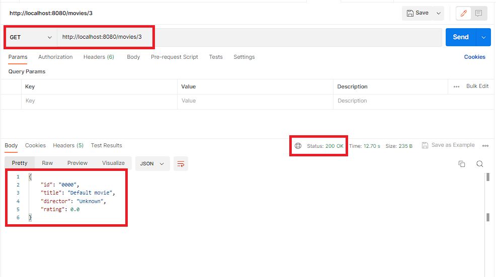

# spring-boot-retry

[](https://github.com/hendisantika/spring-boot-retry-sample/actions/workflows/maven.yml)


A simple app highlighting how we can implement a retry mechanism in Spring Boot using
[Spring Retry](https://github.com/spring-projects/spring-retry).



## Tech Stack

| Component     | Version                                 |
|---------------|-----------------------------------------|
| Java (JDK)    | 25 (Temurin)                            |
| Spring Boot   | 4.1.2 (`spring-boot-starter-webmvc`, `spring-boot-starter-restclient`) |
| Spring Retry  | 2.0.13 (+ `spring-aspects`)             |
| Lombok        | managed by Spring Boot                  |
| Build tool    | Maven (via `./mvnw` wrapper)            |

## How It Works

- `MovieController` (`GET /movies/{id}`) calls `MovieService`, which fetches data through `MovieApiClient`
  (a `RestTemplate` call to the local mock endpoint `GET /mock/movies/{id}`).
- `MovieService#getMovieDetails` is annotated with `@Retryable`: on `HttpServerErrorException`,
  `HttpClientErrorException` or `ResourceAccessException` it retries up to **3 attempts** with a **5 second** backoff.
- When all attempts fail, the `@Recover` method returns a default movie instead of an error.
- `RetryConfig` also exposes a programmatic `RetryTemplate` bean using `CustomRetryPolicy` and a `FixedBackOffPolicy`,
  configurable through `application.properties`:

```properties
retry.maxAttempts=4
retry.backoffInMillis=3000
```

## Requirements

- JDK 25
- No local Maven install needed — use the bundled Maven wrapper

## Build & Run

```shell
# build & run tests
./mvnw clean verify

# run the application
./mvnw spring-boot:run
```

The app starts on <http://localhost:8080>.

## Try It

```shell
# Existing movie (id 1 or 2) -> returned directly
curl http://localhost:8080/movies/1
# {"id":"1","title":"The Matrix","director":"Lana Wachowski, Lilly Wachowski","rating":8.7}

# Unknown movie -> mock returns 500, the call is retried 3 times, then @Recover kicks in
curl http://localhost:8080/movies/99
# {"id":"0000","title":"Default movie","director":"Unknown","rating":0.0}
```

Watch the application log to see each retry attempt being logged before the fallback is returned.

## CI/CD & Dependency Updates

- **GitHub Actions** (`.github/workflows/maven.yml`): builds and tests the project with JDK 25 on every push and
  pull request to `main`, and submits the Maven dependency graph to GitHub.
- **Dependabot** (`.github/dependabot.yml`):
  - Maven updates daily (05:00 Asia/Jakarta), grouped into Spring Boot, Spring, test and Maven plugin groups.
  - GitHub Actions updates weekly, grouped into a single PR.
  - PRs are labelled and use conventional commit prefixes (`build(deps)`, `ci(deps)`).

## Author

**Hendi Santika**

- Email: hendisantika@gmail.com
- Telegram: [@hendisantika34](https://t.me/hendisantika34)
- Link: [s.id/hendisantika](https://s.id/hendisantika)
